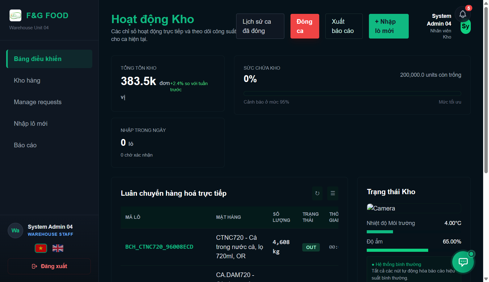
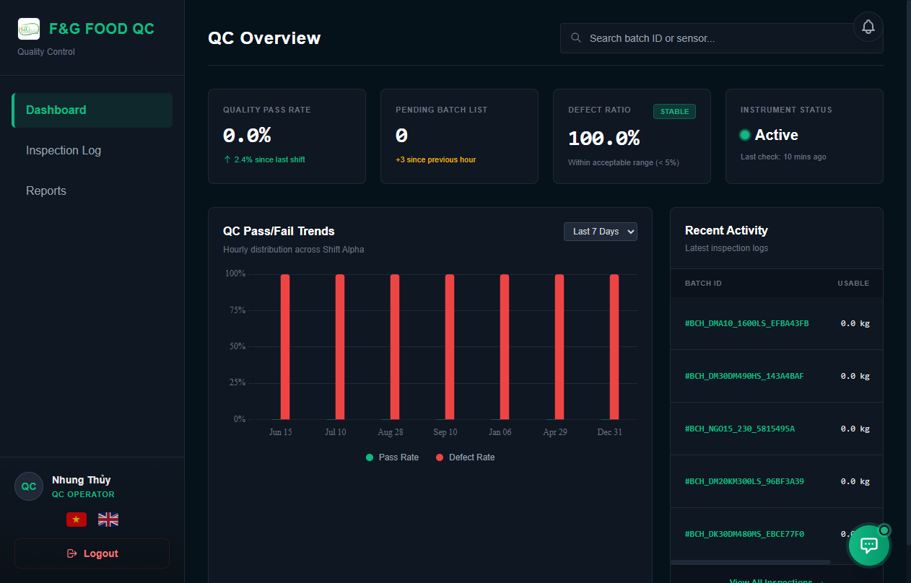
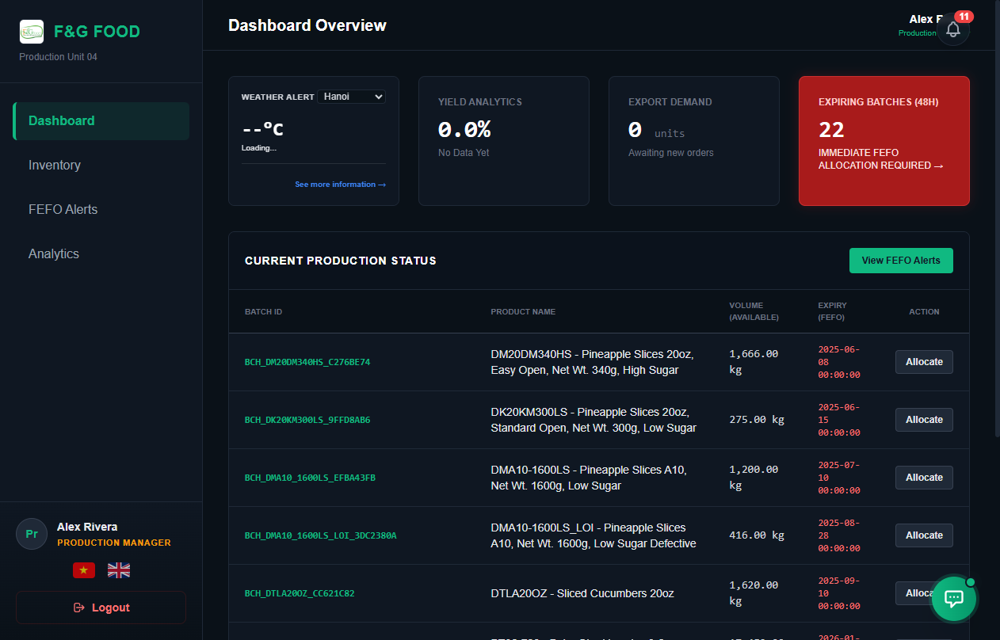
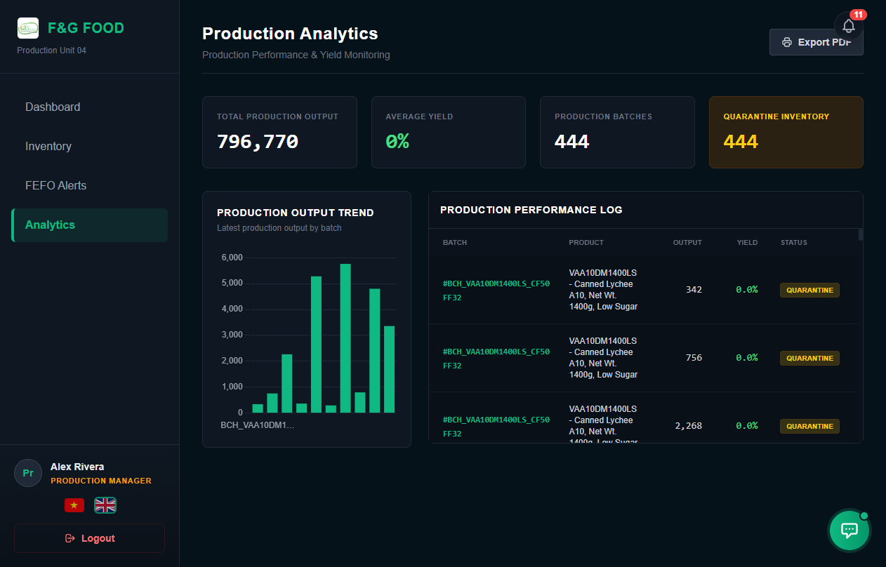

<div align="center">

# F&G: Food Inventory & Production Management System

### Enterprise-Grade Inventory Tracking, Quality Control, Shift Production & Automated FEFO Dispatch

**End-to-End Digital Traceability — From Raw Ingredient Intake to Finished Goods Dispatch**

[](#system-architecture)
[](#system-architecture)
[](#system-architecture)
[](#automated-testing--qa-evidence)
[](#api--n8n-automation)
[](#core-capabilities)
[](#core-capabilities)
[](#license)

<br/>

**[Quick Start](#quick-start) · [Key Features](#key-features) · [System Architecture](#system-architecture) · [Role-Based Access](#role-based-access-control-rbac) · [Automated Testing](#automated-testing--qa-evidence) · [n8n Automation](#api--n8n-automation) · [Troubleshooting](#troubleshooting--faq)**

<br/>

```bash
git clone https://github.com/hoangcamanh/F-G_Food-Inventory-Production-Management-System.git
```

</div>

> [!IMPORTANT]
> **Production & Academic Deployment Notice**:
> This platform is engineered for food manufacturing facilities subject to strict regulatory compliance, perishable shelf-life tracking, and hazard prevention (HACCP). Default credentials for demo evaluation are provided in the [Role-Based Access Control](#role-based-access-control-rbac) section. Ensure MySQL 8.x+ and PHP 8.1+ with PDO extensions are active before launching.

<div align="center">

### System Interface Showcase

| Warehouse Management & Real-time Stock | Quality Control & Inspection Station |
| :---: | :---: |
|  |  |
| **Production FEFO Allocation Engine** | **Executive Analytics & Waste Attribution** |
|  |  |

</div>

---

## Executive Overview

Food and beverage processing operations face stringent regulatory requirements, narrow operating margins, and the perpetual hazard of raw material spoilage. Traditional manual logging methods fail to enforce FIFO/FEFO consistency, resulting in avoidable waste, delayed recall responses, and audit compliance failures.

**F&G Food Inventory & Production Management System** resolves these challenges by introducing an end-to-end digital nervous system designed specifically for food manufacturing:
- **Zero-Waste Dispatch**: Automated First-Expired, First-Out (FEFO) algorithms guarantee near-expiry stock prioritization.
- **Strict Quality Gates**: Quarantined raw materials require rigorous QC inspection approval before production line allocation.
- **Full-Chain Traceability**: Every finished SKU maps directly to the specific raw material batch, operator, inspection certificate, and production shift.
- **Executive Visibility**: Instant waste cost attribution, scrap valuation, and real-time operational KPI dashboards.

---

## Key Features

### 1. Raw Material Inventory & Multi-Zone Warehouse Management
* **Real-time Inventory Ledger**: Live balance tracking categorized by category, supplier, batch code, and storage location.
* **Multi-Zone Segregation**: Distinct physical zone mapping (Dry Storage, Cold Storage, Frozen Vault, Quarantine Area).
* **Automated Stock Movements**: Automatic debit/credit audit trail for every stock-in, QC clearance, allocation, and write-off.
* **Low Stock & Expiry Telemetry**: Instant visual warnings for critical stock thresholds and upcoming shelf-life limits.

### 2. Automated FEFO (First-Expired, First-Out) Dispatch Engine
* **Intelligent Batch Allocation**: System queries active batches and strictly enforces dispatch sorted by expiration date (`EXP_DATE ASC`).
* **Spoilage Prevention Matrix**: Prevents newer batches from being committed while older viable stock remains in storage.
* **Weather-Aware In-Storage Warnings**: Real-time integration with ambient weather data alerts staff to humidity and heat risks on sensitive food supplies.

### 3. Quality Control (QC) & Inspection Gateway
* **Mandatory Intake Inspection**: Incoming goods remain in `Quarantined` state until verified by a QC specialist.
* **Defect Grading & Yield Calculation**: Standardized testing protocols recording sample size, defect quantity, defect classification, and calculated yield percentage.
* **Auto-Rejection Governance**: Automatic status transition to `Rejected` whenever sample yield drops below corporate tolerance thresholds (< 80%).

### 4. Production Batching, Shift Management & Yield Tracking
* **Material Requisitions**: Production Managers submit requisitions with automated stock validation against warehouse ledgers.
* **Shift-Aware Tracking**: Automatic real-time detection of operational warehouse shifts (Morning, Afternoon, Night) based on local timestamps.
* **Yield & Throughput Analytics**: Input-to-output conversion monitoring identifying production bottlenecks and resource wastage.

### 5. Finished Goods Declaration & QR Traceability
* **Shift-Closing Workflows**: Standardized declaration of completed product quantities, target lots, and operator verification.
* **Bidirectional Traceability**: QR code generation providing instantaneous backward and forward pedigree lookups from farm to fork.

### 6. Financial Intelligence & Waste Cost Attribution
* **Scrap & Waste Quantification**: Automated calculation of monetary loss resulting from QC rejections and expired disposals.
* **Supplier Quality Scorecards**: Historical vendor reliability metrics highlighting rejection rates per supplier.

### 7. AI Chatbot & Natural Language SQL Assistant
* **Conversational Warehouse Queries**: Query stock balances, expiring batches, and production metrics using plain Vietnamese or English.
* **Multi-LLM Integration**: Built-in support for **Groq (Llama-3)**, **Google Gemini 1.5**, and **OpenRouter** providers.

### 8. n8n Enterprise Automation & Event Webhooks
* **Automated Email Notifications**: Periodic executive summary emails and instant critical alerts dispatched via webhook triggers.
* **Plug-and-Play JSON Workflows**: Pre-configured n8n workflows for immediate deployment in Docker or self-hosted environments.

### 9. Bilingual Localization (EN / VI) Engine
* **Instant Language Toggle**: Seamless switching between Vietnamese and English across all UI labels, form validations, error modals, and database reference lookups.

---

## Role-Based Access Control (RBAC)

The system implements strict permission segregation across 4 dedicated organizational roles:

| Role | Default Username | Default Password | Initial Landing Page | Core Responsibilities |
| :--- | :--- | :--- | :--- | :--- |
| **Director** | `director_demo` | `123456` | `frontend/dashboard_director.php` | High-level KPI dashboards, financial waste attribution, plant-wide yield metrics, executive audits. |
| **Production Manager** | `pm_alex` | `123456` | `frontend/dashboard_production.php` | Material requisitioning, FEFO batch allocation, shift production tracking, finished goods sign-off. |
| **Warehouse Staff** | `wh_admin04` | `123456` | `frontend/dashboard_warehouse.php` | Stock intake, batch registration, zone management, material issue dispatch, physical inventory audits. |
| **Quality Control (QC)** | `nhung_thuy` | `123456` | `frontend/qc_dashboard.php` | Raw material sampling, inspection verification, defect logging, quarantine approvals, rejection reporting. |

---

## System Architecture

```text
       CLIENT LAYER (Browser)
       ┌────────────────────────────────────────────────────────┐
       │   HTML5 · Tailwind CSS · Bootstrap 5 · Chart.js · QR   │
       │           Instant Bilingual Localization (EN/VI)       │
       └───────────────────────────┬────────────────────────────┘
                                   │ HTTP / JSON REST
       APPLICATION LAYER (Backend PHP 8.x)
       ┌───────────────────────────▼────────────────────────────┐
       │  [Controllers]        [Services]        [Core Auth]    │
       │  • MaterialRequest    • WeatherService  • Session/RBAC │
       │  • StockController    • Notification    • Security     │
       │  • QcController       • AI Bridge       • i18n Engine  │
       └───────────────────────────┬────────────────────────────┘
                                   │ PDO Prepared Queries
       PERSISTENCE LAYER (MySQL 8.x)
       ┌───────────────────────────▼────────────────────────────┐
       │  USERS · BATCHES · PRODUCTS · SUPPLIERS · INSPECTIONS  │
       │  STOCK_MOVEMENTS · FINISHED_GOODS · MATERIAL_REQUESTS  │
       └────────────────────────────────────────────────────────┘
```

### Technology Stack Specifications

| Tier | Technology | Specification / Purpose |
| :--- | :--- | :--- |
| **Backend Runtime** | PHP 8.1 / 8.2 | MVC architecture, strict typed methods, PDO prepared statements, RESTful JSON endpoints. |
| **Database Engine** | MySQL 8.0 / MariaDB 10.4+ | Relational schema with strict foreign keys, indexing on batch lot codes, and UTF-8 collation. |
| **Frontend Framework** | Tailwind CSS & Bootstrap 5 | Modern, responsive interface with Dark/Light accenting, dynamic modals, and interactive data tables. |
| **Data Visualization** | Chart.js 4.x | Real-time yield line charts, waste cost bar charts, and inventory distribution pie charts. |
| **Workflow Automation** | n8n Workflow Automation | Webhook ingestion, automated email dispatch, and scheduled batch expiry triggers. |
| **Artificial Intelligence** | Groq API / Google Gemini API | Natural language prompt parsing into contextual SQL data summaries. |
| **Testing Framework** | Python 3.10+ & Selenium | End-to-end automated test suite verifying all 10 core business modules with screenshot evidence. |

---

## Quick Start

### 1. Prerequisites Checklist
- **Web Server**: Apache 2.4+ (bundled with [XAMPP](https://www.apachefriends.org/) or standalone)
- **PHP**: Version 8.1 or higher (extensions required: `pdo`, `pdo_mysql`, `curl`, `mbstring`, `openssl`)
- **Database**: MySQL 8.0+ or MariaDB 10.4+
- **Python**: Version 3.10+ (for running automated test suites)
- **Web Browser**: Google Chrome or Microsoft Edge

### 2. Installation & Setup

#### Step 1: Clone the Repository
Clone into your web server's document root (e.g., `C:/xampp/htdocs/`):
```bash
cd C:/xampp/htdocs
git clone https://github.com/hoangcamanh/F-G_Food-Inventory-Production-Management-System.git
cd F-G_Food-Inventory-Production-Management-System
```

#### Step 2: Initialize the Database
1. Launch **XAMPP Control Panel** and start **Apache** and **MySQL**.
2. Open **phpMyAdmin** at `http://localhost/phpmyadmin`.
3. Create a new database named `Project2_db`:
   ```sql
   CREATE DATABASE Project2_db CHARACTER SET utf8mb4 COLLATE utf8mb4_unicode_ci;
   ```
4. Import the schema and seed datasets sequentially:
   - File 1: `Project2_db.sql` (Creates core tables, foreign keys, and indexes)
   - File 2: `seed_data.sql` (Inserts realistic demo products, batches, suppliers, shifts, and accounts)

#### Step 3: Configure Environment Variables
Copy or edit `.env` in the project root:
```env
# Ambient Weather Telemetry
WEATHER_API_KEY=your_openweather_api_key

# Generative AI & Natural Language SQL Assistant
GROQ_API_KEY=your_groq_api_key
GEMINI_API_KEY=your_gemini_api_key
OPENROUTER_API_KEY=your_openrouter_api_key

# n8n Automation Webhooks
N8N_WEBHOOK_BASE_URL=http://localhost:5678/webhook
```

#### Step 4: Verify Database Connection
Verify that database credentials in `backend/connection/db_connect.php` match your local environment:
```php
$host     = 'localhost';
$db       = 'Project2_db';
$user     = 'root';
$pass     = '';
$charset  = 'utf8mb4';
```

#### Step 5: Launch the Application
Open your browser and navigate to:
```text
http://localhost/F-G_Food-Inventory-Production-Management-System/frontend/login.php
```
*Log in using any of the demo accounts listed in the [Role-Based Access Control](#role-based-access-control-rbac) table.*

---

## Automated Testing & QA Evidence

The platform includes a test automation suite powered by **Python** and **Selenium WebDriver**, covering 86 end-to-end test cases across 10 distinct modules. Every single test execution automatically logs visual proof into `tests/screenshots/`.

```text
tests/
├── run_all_tests.py            # Master Test Runner (Executes all 10 modules sequentially)
├── run_fresh_tests.py          # Fresh Runner (Flushes screenshots and re-executes clean suite)
├── screenshots/                # Comprehensive image evidence repository
│   ├── module1/ ... module10/  # Organized by functional module
└── test_module/                # Modular test scripts
    ├── test_module1.py         # Module 1: Authentication & Role Authorization (10 TCs)
    ├── test_module2.py         # Module 2: Environment & Master Data Setup (6 TCs)
    ├── test_module3.py         # Module 3: Warehouse Dashboard & Live Alerts (6 TCs)
    ├── test_module4.py         # Module 4: Inventory Ledger & Zone Filtering (10 TCs)
    ├── test_module5.py         # Module 5: Stock-In, Update, Delete & Movements (11 TCs)
    ├── test_module6.py         # Module 6: QC Dashboard, Defect Logging & Inspections (13 TCs)
    ├── test_module7.py         # Module 7: Production Dashboard, Allocation & FEFO (10 TCs)
    ├── test_module8.py         # Module 8: Finished Goods Declaration & Analytics (8 TCs)
    ├── test_module9.py         # Module 9: Material Request Workflow & Reports UI (7 TCs)
    └── test_module10.py        # Module 10: Performance, Responsiveness & Stress (5 TCs)
```

### Running the Test Suite

```bash
# 1. Install Python test dependencies
pip install selenium webdriver-manager

# 2. Execute the entire test suite (all 10 modules, 86 test cases)
python tests/run_all_tests.py

# 3. Or run fresh tests with screenshot flush
python tests/run_fresh_tests.py
```

---

## API & n8n Automation

Pre-built workflow configurations are provided in `n8n_workflows/` to handle enterprise notification dispatching:
- **`flow1_realtime_critical_alerts.json`**: Listens for HTTP POST triggers from `backend/helpers/n8n_helper.php` when critical inventory levels or QC auto-rejections occur. Dispatches immediate warning emails to plant supervisors.
- **`flow2_weekly_summary_flow.json`**: Scheduled cron trigger fetching weekly yield analytics and stock movement volume, generating an executive HTML digest for the plant Director.

### Triggering Manual Test Webhooks:
```bash
curl -X POST http://localhost:5678/webhook/test-alert \
     -H "Content-Type: application/json" \
     -d '{"event":"CRITICAL_STOCK_EXPIRY","batch_id":"BATCH-2026-004","product":"Skimmed Milk Powder","days_remaining":2}'
```

---

## Project Structure

```text
F-G_Food-Inventory-Production-Management-System/
├── .env                              # Environment configuration (API keys, webhooks)
├── .gitignore                        # Git exclusion rules
├── README.md                         # Project documentation and architectural manual
├── Project2_db.sql                  # Primary MySQL schema definition
├── seed_data.sql                    # Seed records (Products, Users, Batches, Shifts)
├── automaticallyMail.n8n            # Legacy root workflow template
├── backend/
│   ├── api/                         # JSON API endpoints (Chatbot, Notifications, Live Search)
│   ├── connection/                  # Database connectivity, login handlers, business actions
│   │   ├── db_connect.php           # PDO connection handler
│   │   ├── fix_pass.php             # Password hash resynchronization tool
│   │   ├── process_login.php        # Role-based authentication processor
│   │   └── process_request.php      # Material requisition lifecycle handler
│   ├── controllers/                 # MVC Controllers (Stock, QC, MaterialRequest, Report)
│   ├── helpers/                     # Helper functions (n8n Webhook dispatch, i18n translators)
│   ├── lang/                        # Bilingual language dictionaries (en.php, vi.php)
│   ├── models/                      # Database models (User, Stock, QC, Shift, Report)
│   └── services/                    # Business service adapters (WeatherAPI, AI Gateway)
├── frontend/
│   ├── assets/                      # Static CSS stylesheets, JavaScript plugins, vendor libraries
│   ├── includes/                    # Shared UI partials (header.php, sidebar.php, footer.php)
│   ├── dashboard_director.php       # Director Executive Overview
│   ├── dashboard_production.php     # Production Line & Yield Management
│   ├── dashboard_warehouse.php      # Warehouse Inventory & In-Out Ledger
│   ├── inventory.php                # Master Inventory Catalog
│   ├── login.php                    # Role-based Secure Login Portal
│   ├── production_FEFO.php          # FEFO Dispatch & Material Allocation Engine
│   ├── qc_dashboard.php             # Quality Control Queue & Inspection Station
│   └── warehouse_reports.php        # Movement Ledger & Waste Cost Reports
├── n8n_workflows/                   # Automated webhook flows and deployment guides
└── tests/                           # Python Selenium automated test suite & visual evidence
    ├── run_all_tests.py             # Master test suite runner
    ├── screenshots/                 # 100+ module execution visual evidence captures
    └── test_module/                 # 10 independent test modules (Module 1 - 10)
```

---

## Troubleshooting & FAQ

<details>
<summary><strong>1. Database connection fails with "Access denied for user 'root'@'localhost'"</strong></summary>

* Open `backend/connection/db_connect.php`.
* Ensure `$pass` is empty `""` (standard default for XAMPP) or set to your custom MySQL root password.
* Verify port 3306 is not blocked by another local service.
</details>

<details>
<summary><strong>2. Unable to log in with demo credentials (Password Verification Error)</strong></summary>

* Ensure you imported `seed_data.sql` after `Project2_db.sql`.
* If password hashes require resynchronization, run the database patch helper in your browser:
  ```text
  http://localhost/F-G_Food-Inventory-Production-Management-System/backend/connection/fix_pass.php
  ```
  This will reset passwords for all accounts to standard `123456`.
</details>

<details>
<summary><strong>3. AI Chatbot responds with API error</strong></summary>

* Verify that your `.env` file contains a valid `GROQ_API_KEY` or `GEMINI_API_KEY`.
* Check that your internet connection is active and that API quotas have not been exceeded.
</details>

<details>
<summary><strong>4. Selenium automated tests cannot find browser driver</strong></summary>

* Make sure Google Chrome is installed on the testing host.
* Install `webdriver-manager` to let Selenium automatically resolve matching ChromeDriver binaries:
  ```bash
  pip install webdriver-manager selenium
  ```
</details>

---

## License & Authors

Distributed under the **MIT License**. See `LICENSE` for more information.

Developed by **[Cam Anh](https://github.com/hoangcamanh)** and the **F&G Food Systems Engineering Team** for the Capstone Project.
For questions, security disclosures, or collaboration inquiries, please open an issue in the repository.

<div align="center">
<sub>Engineered with precision for modern food manufacturing and zero-waste logistics.</sub>
</div>
